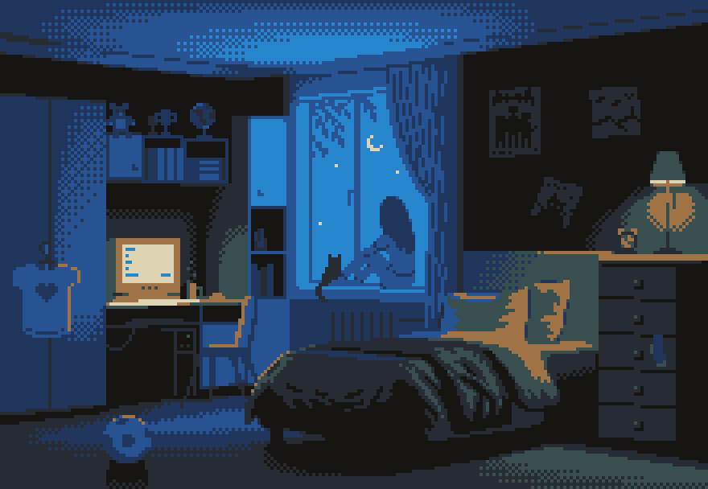

  <a href="https://www.reddit.com/r/gifs/comments/t5jncn/sleepless_night/">
    <picture>
      <source media="(prefers-reduced-motion: reduce)" srcset="./assets/sleepless-night-painterkira.png" />
      
    </picture>
  </a>
  

  <samp>CS student at USC, Cebu.</samp>

  
  
  

<h3 align="center"><samp>tools i use</samp></h3>

  

  

  Banner: <a href="https://www.reddit.com/r/gifs/comments/t5jncn/sleepless_night/">Sleepless Night</a> by <a href="https://www.reddit.com/user/PainterKira/">PainterKira</a> · <a href="./ART_CREDITS.md">art credit</a>

