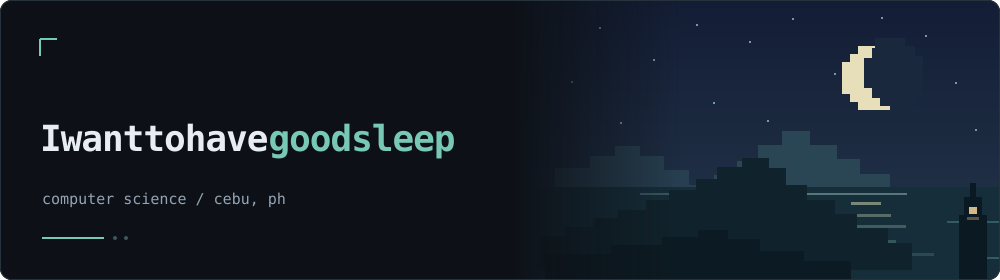

  

  CS student at the University of San Carlos in Cebu. 
  I like Python, solving problems, and figuring out how things work.

 

### things I use

  

  

 

### lately

- Working on [complaint detection in Cebuano-English](https://github.com/Iwanttohavegoodsleep/thesis-work) for our thesis.
- Built [Hubas](https://hubas.vercel.app/) with Team MangoSpace for NASA Space Apps.
- Getting better at building web apps.

 

  
  

